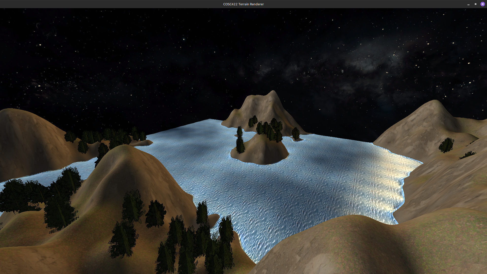

# COSC422 Terrain Renderer

A real-time OpenGL 4.1 terrain renderer for the COSC422 Advanced Computer Graphics course. It generates an infinite, procedurally-noised terrain with water, height/slope-based texturing, and instanced cross-billboard trees, rendered as a first-person scene.



Reference render of the scene: infinite tessellated terrain, water in the lower half, and instanced cross-billboard trees.

## Features

- **Infinite terrain** — a 23x23 vertex grid (100-unit render distance at a 10-unit step) that shifts to follow the camera, so there is no visible edge.
- **Patch tessellation (LOD)** — `GL_PATCHES` primitives with per-patch tessellation levels. Detail is high (100) near the camera and low (30) up to 80 units out, to keep the draw call count bounded.
- **Height and slope texturing** — grass/snow blend with height, rock blends in with slope, sand appears only in the flat beach zone between water level and the shore threshold.
- **Water** — the bottom 50% of the height bound is submerged; terrain fades to deep blue with animated sine waves blended in over a 0.2-unit shore transition.
- **Instanced trees** — up to 4096 cross-billboards drawn in a single `glDrawElementsInstanced` call, sampled from a 3-layer `GL_TEXTURE_2D_ARRAY` (Crabapple, MapleFall, Pine). Placement uses a seeded hash so the forest is deterministic and only recomputed per camera cell.
- **Phong-Blinn lighting** — up to 10 lights, ambient + diffuse + specular, with two fixed lights plus a warm rim light.
- **Wireframe / pause** — press `Z` to toggle wireframe, `Space` to pause the animated waves.

## Requirements

- C++23 compiler and CMake 3.20 or newer
- OpenGL 4.1 with GLEW
- FreeGLUT (GLUT)
- glm
- A GPU that supports 2D texture arrays, patch tessellation, and `glVertexDivisor`

No external package manager or runtime dependencies.

## Installation

```bash
mkdir build && cmake ..
cmake --build build -j
```

This produces `build/terrain_renderer`. The build links against `OpenGL::GL`, `GLUT::GLUT`, `glm::glm`, and `GLEW::GLEW` as configured in `CMakeLists.txt`.

## Usage

```bash
./build/terrain_renderer
```

| Key | Action |
| --- | --- |
| `W` / `S` | Move forward / backward along the view axis |
| `A` / `D` | Move left / right |
| `E` / `Q` | Move up / down (world up) |
| `Z` | Toggle wireframe rendering |
| `Space` | Pause / resume the animated water |
| Left drag | Rotate the camera |

The window is 1024x1024 with a 70-degree field of view and a 0.1 to 10000 near/far range.

## Configuration

All settings in `main.cpp` are compile-time constants:

| Constant | Value | Meaning |
| --- | --- | --- |
| `RENDER_DISTANCE` | `100.0f` | Camera-relative distance the terrain extends |
| `TERRAIN_STEP` | `10.0f` | Spacing between adjacent vertices |
| `GRID_SCALE_FACTOR` | `2.2f` | Grid extends `2.2 * RENDER_DISTANCE` per axis |
| `TESS_LEVEL_HIGH` / `TESS_LEVEL_LOW` | `100.0f` / `30.0f` | Tessellation levels near / far |
| `TESS_DIST_MIN` | `10.0f` | Camera-relative distance where high detail kicks in |
| `TESS_DIST_RANGE_MULT` | `0.8f` | Low-detail zone starts 0.8x render distance out |
| `TERRAIN_HEIGHT_BOUND` | `100.0f` | Terrain is clamped to `[-100, 100]` |
| `TERRAIN_FREQ` / `TERRAIN_AMP` | `0.009f` / `5.0f` | Base Perlin frequency and amplitude (5 octaves) |
| `WATER_LEVEL_NORM` | `0.5f` | Bottom 50% of the height bound is water |
| `WATER_TRANSITION_WIDTH` | `0.2f` | Width over which waves fade in/out |
| `MAX_LIGHTS` | `10` | Uniform array size for lights |
| `POLL_DELAY` | `17` | Frame update interval in milliseconds |
| `TREE_DENSITY` | `0.75f` | Fraction of valid cells that spawn a tree |
| `MAX_TREES` | `4096` | Upper bound on tree count |

`main.cpp` also contains the note:

> Don't attempt to change MAX_LIGHTS unless you will also change the corresponding constant in the fragment shader

## Project Structure

```
main.cpp                      Entry point: window setup, GL init, init/update/display loop
CMakeLists.txt                CMake 3.20 config; C++23; links OpenGL, GLUT, glm, GLEW
headers/
  window.h                    FreeGLUT input callbacks and view/projection matrices
  mesh.h                      Mesh class: VAO/VBO/EBO with interleaved Vertex attributes
  patch_mesh.h                PatchMesh class for GL_PATCHES tessellated geometry
  shader.h                    ShaderProgram loader and uniform-location cache
  texture.h                   Texture loader using stb_image
  stb_image.h                 Embedded stb_image
  basic_objects.h             makeSphere, makeCuboid, makeCrossBillboardTree
  terrain_noise.h             CPU-side Perlin noise and height function (matches the .eval shader)
  tree.h                      Tree placement hashing, slope/height checks, instanced draw
  tree_texture_array.h        Packs the three tree textures into a GL_TEXTURE_2D_ARRAY
shaders/
  terrain.vert / .cont / .eval / .frag   Patch tessellation shader: infinite grid, LOD, waves
  phong_blinn.vert / .frag            Vertex-fragment lighting for sky sphere, Earth, trees
  tree_instanced.vert / .frag         Instanced cross-billboard tree shader (texture array)
assets/
  terrain_textures/           leafy_grass, snow, rock, sand, water (1k diffuse maps)
  tree_textures/              Crabapple, MapleFall, Pine base colours
  solarsystemscope/           Earth day map, Earth specular map, star sky, CC BY 4.0
terrain_renderer.png          Reference render of the scene
```

## Testing

There is no test suite for this project. To verify the build, run:

```bash
mkdir build && cmake .. && cmake --build build -j && ./build/terrain_renderer
```

## License

The Earth day map, Earth specular map, and star sky texture are from https://www.solarsystemscope.com/textures/ and are licensed CC BY 4.0.

The project uses the MIT license. See LICENSE for details.
